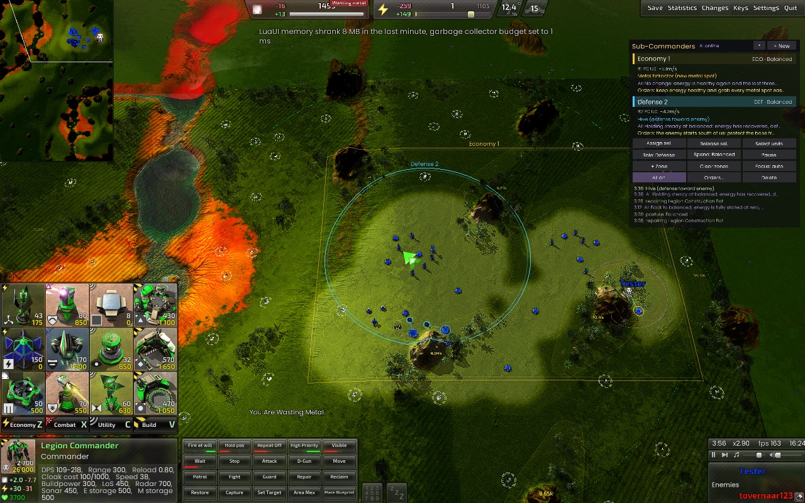
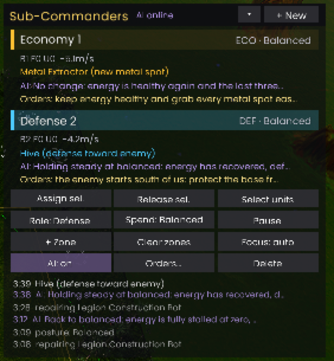
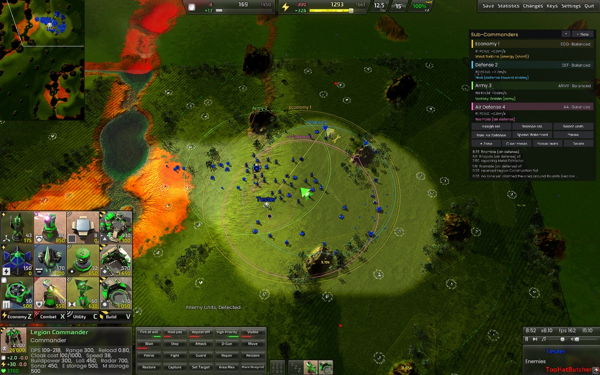

# BAR AI sub-commanders

Delegate parts of your army and base in [Beyond All Reason](https://www.beyondallreason.info/) to
autonomous **sub-commanders**: give one a constructor, a factory or a squad, draw the zone it owns, pick a
role and a spending posture, and it works on its own. Optionally put an **LLM strategist** on top that
reads the situation, follows your orders in plain words and adjusts each sub-commander as the game goes.



- **Roles**: economy, defense, air defense, army, intelligence. Each one builds, produces and fights inside
  its own zones.
- **Knows the enemy**: tracks what the enemy fields (raiders, heavies, artillery, bombers, ...) and what is
  new; turret choice and the strategist answer it.
- **Builds well**: a grid of lanes stays free of structures so units always get through, buildings pack into
  the blocks between them, factory exits stay clear, and it never builds where your constructors are about
  to.
- **Grows by itself**: what its factories produce and the structures its constructors build join it.
  Factories are the exception: they only join when you assign them, so your own production stays yours.
- **Spending postures**: *Conserve*, *Balanced* or *Use all* of the shared team resources.
- **You stay in charge**: order any of its units yourself and it backs off until that unit is idle.
- **Visible**: zones and build plans on the map, a live log per sub-commander.
- **AI strategist** (optional): one [opencode](https://opencode.ai) agent session per sub-commander, with
  role playbooks as skills and a picture of the map. It changes posture, role, focus and zones through tools,
  and can message you ("enemy switched to bombers, coming from the north-east"). Any OpenAI-compatible
  model with tool calling works.
- **Decision model** (optional): a fast "System One" model such as Cloudflare's Clef-flash on a GPU host
  makes the frequent small choices (what a factory builds next) in tens of milliseconds.

## How it works

```
 BAR (Recoil engine)                         scbridge (Docker or local)
┌──────────────────────────────┐           ┌──────────────────────────────────────┐
│ gui_subcommanders.lua        │           │ game link  (tcp 127.0.0.1:7878)      │
│  rules engine: builds,       │           │ MCP tools  (bar_set_posture, ...)    │
│  produces, fights in zones   │           │ strategist: when to review whom      │
│  panel, zones, log           │           │      │ http                          │
│ gui_subcommanders_ai.lua ────┼──────────▶│ opencode serve (agent "subcommander")│──▶ LLM API
│  state every 3 s, actions in │           │  sessions, prompt caching, tools     │
└──────────────────────────────┘           └──────────────────────────────────────┘
```

The rules engine in the widget does all unit-level work, every half second, with no AI involved. The
strategist only changes high-level settings, every 30 s of game time per sub-commander (sooner when
you give new orders, enemies enter its zone or it loses units), so model latency never stalls the game.
Prompts are built so each session's prefix stays stable, and turns mostly hit the prompt cache.

## Requirements

- Beyond All Reason. Developed and tested on macOS with the
  [RecoilEngine Apple Silicon port](https://github.com/benbreen/RecoilEngine-AppleSilicon) (engine 2026.07.04);
  the widgets are plain BAR user widgets, so other platforms should work too.
- User widgets that give unit orders must be allowed in the game. That is the default; a lobby host can
  switch "unit control widgets" off, in which case the panel says so.
- For the AI strategist: Docker, or Go 1.26 + opencode. Plus an API key for an OpenAI-compatible endpoint
  whose model supports tool calling (the default config uses [code.lightning.ai](https://code.lightning.ai)).

## 1. Install the widgets

```sh
git clone https://github.com/rusenask/bar-ai-sub-commanders
cd bar-ai-sub-commanders
make install          # macOS Apple Silicon port; elsewhere: make install BAR_DIR="/path/to/BAR/data"
```

`make install` copies the two files from `widget/LuaUI/Widgets/` into `<BAR data folder>/LuaUI/Widgets/`
(the data folder is the one with `infolog.txt` in it). Start a game; both widgets are on by default
(F11 lists them). Delete the two files to uninstall.

## 2. Use sub-commanders



1. Click **+ New** in the *Sub-Commanders* panel (top right). Right-click makes a Defense one.
2. Select units (constructors, a factory, combat units) and click **Assign sel.**
3. Zones are optional. Without them it works where its role calls for (**Zones: auto**: economy around the
   base, defense at the base's front and exposed extractors, army at the safe edge toward the enemy,
   intelligence on the approaches), recomputed as the game moves. **+ Zone** and drag on the map to draw
   your own (click = circle, shift = draw several, right-click/Esc to stop); **Auto zones** goes back.
4. Pick the **Role** (click to cycle, right-click backwards), **Spend** posture and **Autonomy**:
   *Light* does the basics of its role in its zones; *Balanced* (default) also expands safely, covers
   exposed extractors, helps other areas and counter-pushes when clearly stronger; *Full* also builds
   factories as income grows and lets the army attack and raid on its own when it is stronger.

| Role | Constructors | Factories | Combat units |
|---|---|---|---|
| Economy | metal extractors (+ upgrades), energy, storage when full, converters on surplus, help build, assist factory, reclaim | constructors, up to the posture cap | — |
| Defense | repair, a radar, turrets on the zone edge facing the enemy | 1 constructor, then combat units | fight intruders, patrol zone |
| Air Defense | repair, AA turrets next to the least-covered valuable buildings | 1 constructor, then mobile AA | engage air in zone |
| Army | repair, help build, assist its factory | combat units (without a factory: the economy's factory builds them) | one squad: engages only where its local power beats the threat (turrets count), regroups first, falls back when a fight turns, waits out of reach of known enemy weapons |
| Intelligence | radar net on high ground, cameras at the front, a jammer over the base, sonar on water | scouts, a mobile radar/jammer, then raiders | scouts sweep the map; raiders hunt known enemy radar and jammers |

Economy also takes safe free metal spots just outside its zones and puts construction turrets next to busy
factories when metal piles up. Its factory opens with constructors and raiders, then follows a unit mix by
income (tuned on BARbarian's hard profile and strong players), and sends combat units to an Army that has
no factory. Defense picks turrets against what the enemy fields within a budget (strong players put their
metal into the army) and adds anti-air once enemy aircraft show up. Constructors pull back when enemy
firepower reaches them, and nothing is built where the enemy outguns us (the threat map remembers raids).

**Spend**: *Conserve* spends only from excess, picks cheap options and lowers build priority;
*Use all* picks the strongest affordable options and raises unit caps. Metal extractors and energy are
always allowed when the team is short.

**Focus**: select a unit of the type you want and click **Focus**; its factories then only build those
types, and for turrets its constructors only build those defences (nothing selected = automatic).

The selected sub-commander's zones show the lane grid faintly: structures stay off those lines.

**Overrides**: order any assigned unit and the sub-commander leaves it alone until it is idle again
(white ring on the map). **Pause** stops its decisions; **Release sel.** takes units back for good.

Everything also works as text commands: `/luaui sc help`, `sc new defense`, `sc assign [id]`,
`sc release`, `sc zone [id]`, `sc autozones [id]`, `sc role army [id]`, `sc posture spend [id]`, `sc autonomy full [id]`, `sc focus`,
`sc tell [id] <orders>`, `sc ai on|off [id]`, `sc pause`, `sc resume`, `sc list`, `sc select [id]`,
`sc delete [id]`. Sub-commanders survive `/luaui reload` within a game.

Standing orders for the AI strategist can also be typed in chat: see [Orders from chat](#orders-from-chat).

### Autopilot, and playing against sub-commanders

The **Sub-Commanders Autopilot** widget (off by default; enable it in the widget list) plays the whole team
through sub-commanders: it builds the first lab, then creates Economy, Defense, Army (with a second lab),
Air Defense and Intelligence, gives each standing orders and adds labs when metal piles up. Enabled
mid-game it takes over what you have. `/luaui autopilot ai` turns the AI strategist on for its
sub-commanders, `/luaui autopilot rules` off.

To play **against** sub-commanders on your machine (macOS):

```sh
make up install       # once: bridges (yours on 7878, the bot's on 7879) and the widgets
make play-vs          # that's it: you Armada, the bot a random faction, AI strategist on
```

Your BAR hosts a 1v1 and a second, small BAR window joins as the bot player, whose team the autopilot runs
(`play/bot/` is its separate write dir). The bot's sub-commanders use the AI strategist through their own
bridge (the `scbridge-bot` service); if it isn't running they play on rules alone. Optional:
`YOU=Cortex BOT=Legion MAP="Altair_Crossing_V4.1" BARB=ally:hard BOT_AI=0` (`BARB` adds a BARbarian AI to
your side or the bot's). Both windows run the full game, so expect it to be heavier than a normal skirmish.

How strong is it? Rules-only sub-commanders survive BARbarian medium most of the time but haven't beaten
it yet, and lose to hard (see [docs/research/test-games.md](docs/research/test-games.md)). Every
improvement to the sub-commanders makes the bot stronger too.

<br clear="right">

## 3. Set up the AI strategist locally

The game widget connects to `127.0.0.1:7878`. Run the bridge there, with Docker (recommended) or directly.

### Option A: Docker

1. **API key**: put the key for your LLM endpoint in a file and point `.env` at it:

   ```sh
   mkdir -p secrets && printf '%s' 'YOUR_API_KEY' > secrets/llm_api_key
   cp .env.example .env        # LLM_API_KEY_FILE=./secrets/llm_api_key, MODEL=lightning/deepseek-v4.1-flash
   ```

   The key is mounted read-only into the container as a Docker secret; it is never baked into the image.

2. **Provider** (skip if you use code.lightning.ai): the container has its own opencode config,
   [`docker/opencode.json`](docker/opencode.json). Replace the `lightning` provider with yours, e.g.

   ```json
   "enabled_providers": ["myllm"],
   "provider": {
     "myllm": {
       "npm": "@ai-sdk/openai-compatible",
       "options": { "baseURL": "https://api.example.com/v1", "apiKey": "{file:/run/secrets/llm_api_key}" },
       "models": { "my-model": { "tool_call": true, "limit": { "context": 128000, "output": 8192 } } }
     }
   }
   ```

   and set `MODEL=myllm/my-model` in `.env`. Fast models work best (reviews are frequent and short).

3. **Start it**:

   ```sh
   make up      # build and start; it restarts with Docker until you stop it
   make logs    # one line per review: why, tools used, tokens, cache hits
   make down    # stop
   ```

4. **In game**: the panel header shows **AI online**. Select a sub-commander, click **AI: off** to switch
   it on, and **Orders…** to give it standing orders in plain words, e.g. *"hold the north ridge,
   prioritise anti-air"* (Enter saves, Esc cancels), or type them in chat (below). Purple lines in its log
   are the strategist's decisions.

5. **Watch it think** (optional): `opencode attach http://127.0.0.1:4517` opens the live sessions, one per
   sub-commander, with every tool call.

Ports are published on 127.0.0.1 only: 7878 for the game, 4517 for `opencode attach`. Sessions persist in
the `opencode-data` volume.

### Option B: without Docker

Needs Go 1.26 and [opencode](https://opencode.ai/docs/) with your provider configured in your own opencode
config (`~/.config/opencode/opencode.json`), e.g. the same provider block as above with your real key
reference.

```sh
make run MODEL=myllm/my-model      # builds bin/scbridge and starts `opencode serve` in strategist/
```

Stop the container first if it runs (both use port 7878).

### Orders from chat

Press Enter, start the message with `@` and send it:

| You type | Goes to |
|---|---|
| `@2 hold the north ridge` | sub-commander 2 |
| `@eco expand east` | the first one whose name or role starts with "eco" |
| `@ hold here` | the one selected in the panel |
| `@all fall back` | every sub-commander |
| `@2` with nothing after it | clears 2's orders |

The console confirms each one, e.g. `[Economy 2] orders received`, and warns when that sub-commander's AI
is off (only the AI strategist acts on orders). The orders replace the previous ones, so say everything it
should keep doing in one message.

It is still a real chat message: BAR doesn't let a widget catch text before it is sent, so the widget reads
your own lines back from the chat log. Allies see your orders (BAR's chat defaults to allies-only); in
all-chat (Ctrl+Enter) the enemy sees them too. `/luaui sc tell [id] <orders>` does the same without
sending anything.

### Tuning

- The strategist's instructions are in [`strategist/prompts/subcommander.md`](strategist/prompts/subcommander.md)
  and the agent in [`strategist/opencode.json`](strategist/opencode.json) (it may only use the `bar_*` tools).
  After edits: `make restart` (Docker) or restart `make run`.
- `scbridge` flags: `-model`, `-variant` (reasoning effort), `-interval` (routine review, default 30s game time),
  `-urgent` (minimum gap when something happens, default 8s), `-turn-timeout`, `-opencode-url` (use an already
  running opencode server), `-game-addr`, `-mcp-addr` (must match `strategist/opencode.json`).
- The game side address can be changed with `SubCommandersBridge = host:port` in `springsettings.cfg`.

### Strategist tools

| Tool | Effect |
|---|---|
| `get_overview` | team economy, every sub-commander, enemy intel |
| `get_build_options` | what its constructors and factories can build |
| `get_map_view` | a picture of the map (terrain, grid in elmos, zones, metal, units, enemies) or a close-up of its zones |
| `set_posture`, `set_role`, `set_focus` | the same switches as the panel |
| `add_zone`, `clear_zones` | move or extend where it works (cleared = automatic zones) |
| `set_autonomy` | light / balanced / full: how much the rules do on their own |
| `get_structures` | its own structures with positions, flagging ones that block a factory exit |
| `remove_structures` | its constructors reclaim those structures (never factories); red rings on the map |
| `set_paused` | stop its automatic decisions |
| `tell_player` | console message to you (at most one per 90 s) |

Each sub-commander only accepts tool calls while its own review is running, and only while the AI is on.

The strategist also loads **skills** from [`strategist/.agents/skills`](strategist/.agents/skills): a playbook
per role (economy, defense, airdefense, army, intelligence), reading the enemy intel, and working alongside
the player. Each report carries the enemy's composition (kinds seen in the last 5 minutes and what's new),
known enemy radar/jammers and defences, and what the player is building in its zones.

## 4. Decision model (optional)

A decision model answers small multiple-choice questions ("which unit next, given what the enemy fields?")
with calibrated probabilities in tens of milliseconds, without generating text. The widget asks it through
the bridge and falls back to its rules when it is slow or absent. Today it picks the next combat unit for
Army and Air Defense factories (unless a focus is set).

Any server speaking TypeSafe's `/v1/systemone` contract works. On BAR decisions
(`make decider-eval DECIDER_URL=...`, 16 cases: counters, attack or hold, builder priorities, turret choice)
on an RTX 4090:

| Model | Correct | Median latency | VRAM |
|---|---|---|---|
| [Cloudflare Clef-flash](https://huggingface.co/Cloudflare/clef-flash) (9B, Apache-2.0) | 12/16 | 66 ms | 19 GB |
| [Kev-9B](https://github.com/jaredpalmer/kev) | 11/16 | 101 ms | 22 GB |
| Kev-4B | 9/16 | 73 ms | 15 GB |

Deploy on a Linux GPU host you can ssh to, then point the bridge at it:

```sh
make decider-deploy DECIDER_HOST=my-gpu-host DECIDER=clef-flash   # or kev-4b / kev-9b; serves on :8010 (Kev :8009)
echo "DECIDER_URL=http://my-gpu-host:8010" >> .env && make up
```

The panel's log shows `factory: <unit> (decision model)` and `turrets: <type> (decision model)` when it
decides (it picks Army / Air Defense factory production and the Defense turret type).

In practice: in 6 + 6 fast rules-only games against BARbarian medium, with and without Clef-flash, results
were the same within the (large) game-to-game variance. The model's picks are sensible, but the rules
already choose reasonably, so treat it as an experiment rather than a strength upgrade.

### Our own models

We also trained our own decision models on BAR outcomes ([design/decision-models.md](design/decision-models.md)):
BARbarian vs BARbarian games watched by a logging widget, labels from what actually happened (did the fight
go our way, did the turret or unit pay for itself), Kev-0.8B fine-tuned on a Lightning studio. They predict
far better than the released models or today's rules (fight outcome AUC 0.81 vs 0.57-0.62), and match
gradient-boosted trees. In game they made the army fight more but didn't win more games yet, so they're off
by default. To try them, serve them on a GPU host (`deploy/decider/decider.sh start bar v2`) and route the
tasks: `DECIDER_ROUTES=fight=http://host:8011,unit=http://host:8012,turret=http://host:8013` in `.env`
(passed to the bridge as `SCBRIDGE_DECIDER_ROUTES`), then `make up`.

### Troubleshooting

| Symptom | Fix |
|---|---|
| Header says **AI offline** | the bridge isn't running: `make up` (or `make run`); check `make logs` |
| A sub-commander shows `strategist error: ...` | usually provider config or key; `make logs` has the details |
| "Unit-control widgets are disabled in this game" | the lobby disallows them; sub-commanders can't give orders there |
| "LuaSocket is disabled" in the console | set `LuaSocketEnabled = 1` in `springsettings.cfg` |

## Development

| Path | What |
|---|---|
| `widget/LuaUI/Widgets/gui_subcommanders.lua` | sub-commanders: panel, zones, roles, executor, `WG.SubCommanders` API |
| `widget/LuaUI/Widgets/gui_subcommanders_ai.lua` | LuaSocket link to the bridge (JSON lines) |
| `cmd/scbridge`, `internal/` | bridge: game link, MCP tool server, strategist scheduler, opencode client |
| `strategist/` | opencode project: `subcommander` agent, prompt, skills (`.agents/skills`) |
| `internal/mapview`, `internal/decider` | map pictures for the strategist; decision model client |
| `deploy/decider/`, `cmd/decidereval` | decision model server scripts (Clef / Kev) and its BAR benchmark |
| `Dockerfile`, `compose.yaml`, `docker/opencode.json` | container image (official opencode image + scbridge) |
| `cmd/fakegame` | scripted stand-in for the game, to work on the bridge without BAR |
| `cmd/gamereport`, `internal/analysis` | game analysis: reports, A/B comparison, strong players' benchmark |
| `.claude/skills/`, `docs/research/` | how we improve the AI (skills for coding agents), lessons and results |
| `testenv/` | scripted test games |

- `make lint` (luac, the engine modules' unit tests `make test-lua`, go vet), `make build`.
- The executor's engine is split into plain-Lua modules in `widget/LuaUI/Include/` (design/engine.md):
  `sc_doctrine` (tuning as data), `sc_threatmap` (world model), `sc_pathing`, `sc_squads`,
  `sc_production`, `sc_autozones`; tests in `widget/tests/`. Tune numbers in `sc_doctrine.lua` and
  measure with an A/B batch.
- `make test-game SCENARIO=multi` (macOS) launches an isolated windowed skirmish: separate write dir
  `testenv/`, your BAR content read-only. `testenv/LuaUI/Widgets/zz_sctest.lua` drives the scenario
  (`eco`, `multi`, `ui`, `lanes`, `factory`, `ai`, `vsai`) and writes `testenv/sctest_out.txt` and
  screenshots; the full engine log is `testenv/run.log`. Test games talk to a separate bridge on port 17878:
  `make test-bridge` (add `DECIDER_URL=...` to test a decision model).
- 1v1 against BARbarian, no cheats, the harness playing a light-touch human who delegates (first lab,
  constructors and factories to sub-commanders, standing orders, another lab when metal piles up):
  `make test-game SCENARIO=duel SCRIPT=script_vsai.txt AI_PROFILE=medium TIMEOUT=1100` (`duelrules` = rules
  only, no strategist; profiles easy, medium, hard, hard_aggressive). It ends with
  `RESULT WIN|LOSS|TIMEOUT` and team stats.
- Faster: `SPEED=15` runs any scenario at up to 15x (a 25-minute duel takes about two minutes here);
  `LOCKSTEP=1` slows the game to real time while the strategist thinks, so it sees the game as it would
  in a real one; `MAP="Altair_Crossing_V4.1"` picks another map (names as in BAR's archive cache);
  `DUEL_MINUTES=40` plays longer. Test windows are small (800x500), never fullscreen.
- `make test-batch GAMES=8 LABEL=my-change` plays several fast games (`BATCH_SCENARIO`, `AI_PROFILE`, `MAP`
  as above), one at a time at lower CPU priority (`WORKERS=3` runs three at once on separate write dirs), and keeps them in
  `testenv/batch/<date>-<label>/` with `meta.txt` (commit, settings, how many ran) and `report.md`. A game
  that didn't run is retried once; one that stalls is killed. `WIDGET_SRC=$(testenv/arm.sh name [commit])`
  runs a frozen version of the widgets, for A/B comparisons. Results so far: [docs/research/test-games.md](docs/research/test-games.md).
- `bin/fakegame` exercises the bridge and the model without starting BAR.

### Analysing games and improving

- `make report` (the latest batch; `BATCH=<dir or log>` for others) runs `cmd/gamereport`: results, economy
  pace against strong players' 1v1s (quartiles per minute), losses by kind, the sub-commanders' recurring
  problems and a ranked list of findings. `make compare ARMS="<dir A> <dir B>"` puts A/B arms side by side.
- The harness logs per-minute `eco` lines and every unit `lost` / `killed` in the same terms as the replay
  data logger, so our games and strong players' games compare directly.
- Strong players' games: `testenv/pro_replays.py` downloads rated 1v1 replays from BAR's public archive and
  `testenv/replays.sh` plays them with the data logger; `make benchmarks` rebuilds
  `internal/analysis/benchmarks/pro-duel.json`, which the reports and the strategist's "Pace" line use.
  See [design/pro-replays.md](design/pro-replays.md).
- The improvement process (measure, pick the top finding, change, A/B, record) is written down as skills
  in `.claude/skills/` (`improve`, `analyze-games`, `ab-test`, `pro-replays`, `decision-models`) and its
  memory is [docs/research/lessons.md](docs/research/lessons.md) plus
  [docs/research/test-games.md](docs/research/test-games.md).
- `make ref` checks out BAR's Lua source at the installed version into `ref/` for API lookups.

Other widgets can drive sub-commanders through `WG.SubCommanders`: `list()`, `get(id)`, `economy()`,
`enemyIntel()`, `buildOptions(id)`, `structures(id, kind, blockingOnly)`,
`removeStructures(id, unitIDs)`, `mapView(id, view)`, `create(role, name)`, `remove(id)`, `assign(id, unitIDs)`,
`release(unitIDs)`, `setRole`, `setPosture`, `setAutonomy(id, level)`, `setPaused`, `addZone(id, zone)`, `clearZones`,
`setFocus(id, unitDefNames)`, `setAI(id, on)`, `setDirective(id, text)`, `note(id, text)`,
`noteAI(id, text)`, `setAIStatus(id, text)`, `ownerOf(unitID)`. Zones are
`{ kind = "rect", x1, z1, x2, z2 }` or `{ kind = "circle", x, z, r }` in world coordinates.



## Limits

- Building placement is a heuristic search on a lane grid, not a planned base layout: lanes every 320 elmos,
  a clear lane in front of every factory exit (own and allied) and room around factories. It doesn't yet
  reason about cliffs and ramps beyond the zones the strategist picks.
- Armies attack on their own only at *Full* autonomy; otherwise the strategist (or the player) moves the
  army's zone forward.
- Strength, measured in fast 1v1 test games with a light-touch delegating player (details in
  [docs/research/test-games.md](docs/research/test-games.md)): against BARbarian medium, 5 of 6 games still
  standing at 25 minutes, none won; against hard, 1 of 6. Units still trade badly (about 1 kill per 4
  losses), and the AI strategist doesn't add measurable strength against a scripted AI: its value is
  following your orders and explaining itself.
- Geothermal, nukes, long-range artillery and factories are not built automatically. Give an Army
  sub-commander a factory to produce with; until then it asks for one.
- Metal extractor upgrades by T2 constructors are implemented but untested.
- The strategist changes settings and can remove its own structures; it cannot order a specific building
  (it asks you instead).

## License

GPL-2.0, like the BAR widgets it builds on. See [LICENSE](LICENSE).
